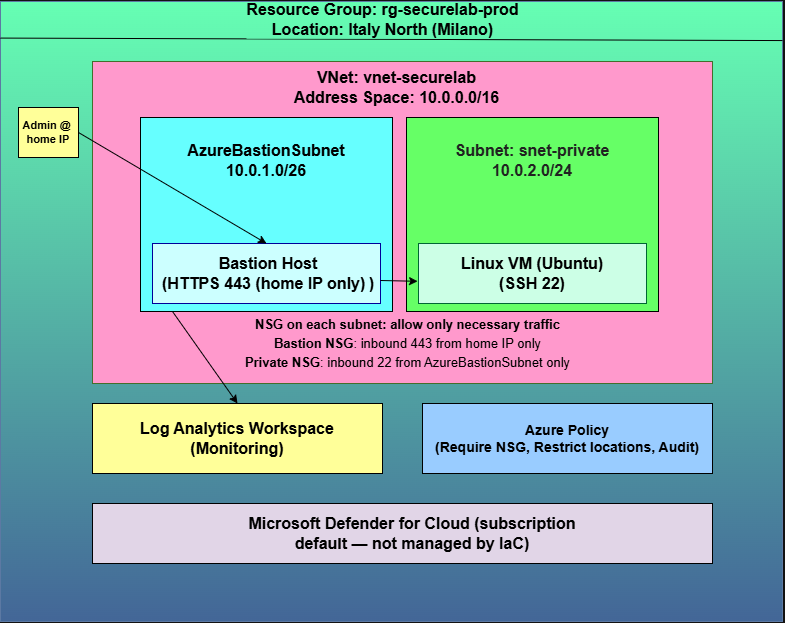

# Azure Secure Foundation Lab — Zero Trust IaC

> Fully automated Azure Zero Trust foundation lab built with Terraform:
> segmented VNet, Linux VM with **no public IP** reachable **only** through
> Azure Bastion, least-privilege NSGs, governance via Azure Policy and
> centralized monitoring on Log Analytics.
> **Every resource lives in code: zero manual configuration.**

## 🎯 Why this project

A personal lab designed to prove, end to end, that I can *build, break, debug
and decommission* real cloud infrastructure — not just click it into existence:

- Infrastructure as Code with Terraform (idempotent, reproducible, destroyable)
- Zero Trust network design: one door, one key, one allowed source IP
- Governance as code: Azure Policy guardrails on the whole resource group
- Cost governance: the lab lives only when I decide so (`apply` → demo → `destroy`)

## 🏗️ Architecture



**Access flow (the whole point):**
1. Admin (home IP, `/32` allow-list) → **HTTPS 443** → Azure Bastion (only public surface)
2. Bastion → **SSH 22** → Linux VM (private IP only, key-only auth, passphrase-protected key)

**Platform services:** Log Analytics workspace (diagnostic settings from Bastion/NSG/VNet),
three Azure Policy assignments (allowed locations, NSG required on subnets, audit-grade VM
compliance). Microsoft Defender for Cloud Free Tier is a *subscription default* and is
intentionally **not** managed by IaC.

## 🔐 Security controls

| Control | Implementation |
|---|---|
| No public exposure of the workload | VM NIC is private-only; SSH exclusively via Bastion |
| Key-only authentication | `disable_password_authentication` left at default (`true`); `admin_ssh_key` with passphrase-protected key |
| Perimeter allow-list | Bastion NSG: inbound 443 **only** from admin home IP `/32` |
| East-west segmentation | Two subnets; private NSG allows 22 **only** from `AzureBastionSubnet` |
| Governance | Azure Policy assignments scoped to the resource group |
| Audit trail | Diagnostic settings → Log Analytics (Bastion audit logs included) |
| Secrets hygiene | `terraform.tfvars` gitignored; only `terraform.tfvars.example` is committed |

## 🧱 Repository structure

```
azure-secure-foundation-lab/
├── main.tf                  # networking, compute, Bastion
├── variables.tf             # input variables
├── outputs.tf               # the "registry": names & IPs via `terraform output`
├── monitoring.tf            # Log Analytics + diagnostic settings
├── policies.tf              # Azure Policy assignments
├── scripts/deploy.sh        # one-shot deploy helper
├── terraform.tfvars.example # template for local secrets/values
└── docs/                    # architecture diagram + Bastion session screenshot
```

## 🚀 Quickstart

**Prerequisites:** Azure subscription, Terraform ≥ 1.5, Azure CLI, OpenSSH.

```bash
git clone https://github.com/robdl93/azure-secure-foundation-lab.git
cd azure-secure-foundation-lab

ssh-keygen -t rsa -b 4096          # keep the passphrase: Bastion will ask it in "SSH Passphrase"
cp terraform.tfvars.example terraform.tfvars   # fill: admin username, your home IP as /32

az login
terraform init
terraform plan
terraform apply
```

**Connect:** Portal → Virtual Machine → *Connect* → *Bastion* →
*SSH Private Key from Local File* + **SSH Passphrase** field.


**Teardown:** `terraform destroy` — the lab is designed to cost €0 while asleep.

## 💶 Cost governance

- Pay-as-you-go lab: ≈ €0.25–0.35/hour while running (Bastion bills per hour even when idle).
- House rule: `apply` → demo → `destroy` in the same day.
- There is no "pause" button in Azure: **IaC is the pause button** (`destroy` = €0, `apply` = ~10 min).

## 📚 Lessons learned (the real deliverable)

| Symptom | Root cause | Fix / lesson |
|---|---|---|
| Plan errors after provider upgrade | azurerm 3.x → 4.x breaking changes | Pin providers, read upgrade guides, treat `terraform validate` as a first-class citizen |
| `MissingSubscriptionRegistration`, then `409 InvalidAuthenticationToken … register with Microsoft.Insights` | Resource providers unregistered + **eventual** propagation of registration | `az provider register --namespace X --wait`; verify with a read-only call; split the deploy when the platform misbehaves |
| `SkuNotAvailable: Standard_B1s … ItalyNorth` | Region-specific SKU catalogs: newer regions don't sell legacy burstable sizes | `az vm list-skus --location <region>` is the source of truth; replanned to `Standard_D2als_v7` |
| `PolicyDefinitionNotFound` | Placeholder policy IDs copied from a tutorial | Query real built-in definitions (`az policy definition list`); never trust copied IDs |
| `ERR_CONNECTION_TIMED_OUT` on Bastion session | Dynamic home IP changed; the NSG allow-list *correctly* locked me out | Rotate allow-lists via IaC, never by hand; IP allow-lists on dynamic lines are fragile — enterprise answer is Entra ID / Conditional Access |
| Bastion "Disconnected" despite valid key | Passphrase-protected private key: Bastion needs it in the dedicated **SSH Passphrase** field | Interrogate the artifact (`ssh-keygen -y -f id_rsa`) instead of guessing; generic errors hide specific causes |

## 🧭 Roadmap (v2 ideas)

- Secrets in Azure Key Vault (with `AuditEvent` on reads)
- Entra ID authentication on Bastion (retire the IP allow-list)
- Hub & spoke topology + Private Endpoints
- Budget alerts and cost caps wired into CI
- GitHub Actions: `plan` on PR, `apply` on merge

## ⚠️ Disclaimer

Personal learning lab. Resources are billable: always `terraform destroy` when done.
Not production-grade, no warranty implied.

## 👤 Author

**Roberto De Luca** — [LinkedIn](https://www.linkedin.com/in/robertodeluca93/)